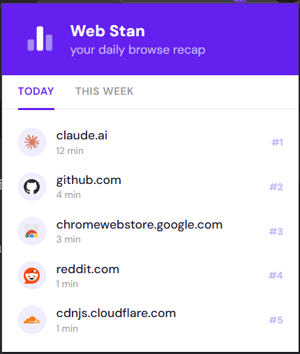
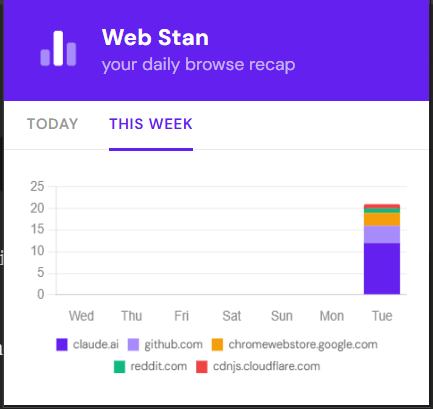

# Web Stan

A simple Chrome extension that tracks how much time you spend on different websites. I built this to see my actual browsing habits without using an app that forces you to make an account or tracks your data. Everything is saved locally in your browser.

## Preview
| Today's Top Sites | Weekly Breakdown |
|---|---|
|  |  |

## Features
* Shows your top 5 sites by time spent today
* Stacked bar chart of your top 5 sites over the last 7 days
* Pauses tracking when you go idle, lock your screen, or unfocus Chrome
* Auto-deletes data older than 30 days
* Uses `chrome.storage.local` for data and Chrome's built-in favicon cache for site icons

## How to install
This isn't on the Chrome Web Store yet. To load it manually:

1. Download or clone this repository.
2. Open Chrome and go to `chrome://extensions`.
3. Turn on Developer mode in the top right.
4. Click "Load unpacked" and select the project folder.
5. Pin the extension to your toolbar.

## Permissions used
* `storage`: Saving your time stats locally
* `tabs`: Reading the URL of your active tab
* `alarms`: Running the background save and daily cleanup tasks
* `idle`: Pausing the timer when you step away

## Tech
* Vanilla JS, HTML, CSS
* Manifest V3
* Chart.js 4.4.1 (included in `lib/`)

## License
MIT. See LICENSE for details.
